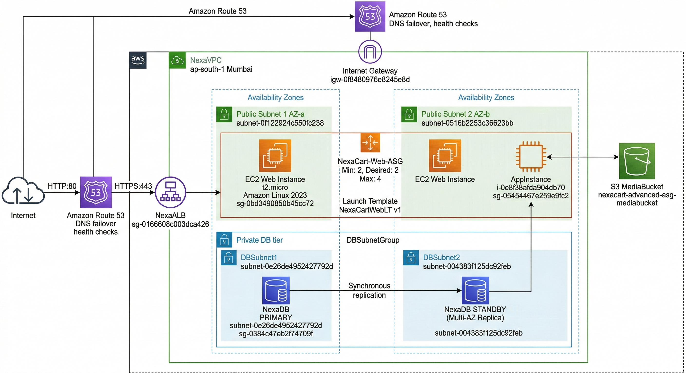

# NexaCart – Enterprise Cloud Migration on AWS

Migration design and Infrastructure-as-Code deployment for **NexaCart Solutions**, a Sri Lankan e-commerce business (~60,000 orders/month, ~150 staff), moving from on-premises servers to a highly available, disaster-resilient AWS architecture.

> Built for the *Enterprise Cloud and Infrastructure Automation* module (Staffordshire University, BSc (Hons) Computer Science – Cloud Technologies). The core stack was deployed with AWS CloudFormation in an AWS Academy lab environment.



---

## Problem

NexaCart ran on a small on-premises estate (3× Dell PowerEdge T40 web servers, a single application server and a single database server). This setup:

- was sized for peak traffic, so capacity sat idle most of the day,
- had single points of failure at the app and database tiers,
- had no plan for a site or regional outage.

## Solution

A 3-tier web architecture built to the **AWS Well-Architected Framework**, defined entirely in **AWS CloudFormation**.

| Tier | Design |
|---|---|
| **Network** | Custom VPC across 2 Availability Zones, Internet Gateway, public subnets for web/app, private subnets for the database |
| **Edge** | Application Load Balancer (NexaALB) with health checks; Route 53 DNS failover |
| **Compute** | EC2 Auto Scaling Group `NexaCart-Web-ASG` (min 2 / desired 2 / max 4, t2.micro, Amazon Linux 2023) from Launch Template `NexaCartWebLT`, plus an application server |
| **Data** | Amazon RDS MySQL in a DB subnet group across 2 AZs (Multi-AZ in the target design), S3 media bucket for product images |
| **Security** | Tiered Security Groups – ALB ← Internet, Web ← ALB only, DB ← App/Web only; database has no internet route |

### Migration strategy (7 Rs)

| On-premises component | Strategy | AWS target |
|---|---|---|
| 3× web servers | Replatform | EC2 Auto Scaling behind ALB |
| Application server | Replatform | EC2 behind ALB |
| Database server | Replatform | Amazon RDS (MySQL) Multi-AZ |
| File server (NAS) | Replatform | Amazon S3 |
| Email server | Repurchase | Amazon WorkMail / SaaS |
| Backups | Replatform | AWS Backup + S3 / Glacier |
| Firewall | Replatform | Security Groups + NACLs |

---

## Deployed with CloudFormation

Stack **`NexaCart-Advanced-ASG`** reached `CREATE_COMPLETE` with **24 resources**, including:

- `NexaVPC`, `NexaIGW`, route table + default route, 2 public subnets, 2 DB subnets
- `DBSubnetGroup`, `NexaDB` (RDS)
- `NexaALB`, `ALBListener` (HTTP :80), `ALBTargetGroup`
- `WebLaunchTemplate` (NexaCartWebLT), `WebASG` (NexaCart-Web-ASG)
- `MediaBucket` (S3)
- `ALBSecurityGroup`, `WebSecurityGroup`, `AppSecurityGroup`, `DBSecurityGroup`
- `AppInstance` (EC2)

**Template practices used**

- Latest Amazon Linux 2023 AMI resolved through SSM Parameter Store (no hard-coded AMI IDs)
- Parameterised instance types, capacity and CIDR blocks, so one template serves dev, staging and production
- One Security Group per tier (least privilege)
- CloudFormation as the single source of truth (no manual console changes)
- Database credentials referenced from AWS Secrets Manager instead of being stored in the template

### Lab limitations

AWS Academy restrictions meant these production features are **designed but not deployed**:

- HTTPS listener on the ALB (needs an ACM certificate and a registered domain)
- RDS Multi-AZ (deployed as single-AZ in the lab)
- CloudFront CDN, AWS WAF, VPC endpoints
- The cross-region warm-standby DR site described below

---

## Disaster recovery – Warm Standby

| | Primary | Warm standby |
|---|---|---|
| **Region** | ap-south-1 (Mumbai) | ap-southeast-1 (Singapore) |
| **Compute** | ASG 2–4 instances across 2 AZs | Standby ASG at 0–1 instances, scales to 4 on failover |
| **Database** | RDS MySQL Multi-AZ (synchronous) | Cross-region RDS Read Replica (asynchronous), promoted on failover |
| **Storage** | S3 MediaBucket | S3 Cross-Region Replication target |
| **Traffic** | Route 53 health checks on the primary ALB | Route 53 fails DNS over to the Singapore ALB |

**Backups:** AWS Backup with daily RDS snapshots (35-day retention), weekly EC2 AMIs, S3 versioning, and S3 Glacier for 1-year compliance archives.

### Recovery objectives

| Scenario | Recovery time |
|---|---|
| Availability Zone failure | 60–120 seconds (RDS Multi-AZ automatic failover) |
| Region failover to Singapore | ~25–35 minutes end-to-end (runbook below) |
| Backup & restore fallback | ~2–4 hours |

**Targets:** RTO 15–30 minutes, RPO ≤ 1 hour.

### Failover runbook (summary)

1. **Detect:** CloudWatch alarms and Route 53 health checks fail for the Mumbai ALB or RDS.
2. **Assess:** confirm the failure is region-level. AZ failures are handled automatically by Multi-AZ.
3. **Database:** promote the Singapore Read Replica to primary (~5–10 minutes).
4. **Compute:** raise the Singapore ASG desired capacity from 1 to 4.
5. **DNS:** Route 53 sends 100% of traffic to the Singapore ALB.
6. **Validate:** smoke-test orders, payments and inventory.

---

## Evidence

### CloudFormation stack (24 resources)


### Launch template


### Auto Scaling group


### Live website through the ALB


---

## Repository structure

```
nexacart-aws-cloud-migration/
├── cloudformation/
│   └── nexacart-advanced-asg.yaml
├── docs/
│   ├── architecture/
│   │   └── nexacart-architecture.png
│   └── screenshots/
│       ├── cloudformation-resources-1.jpeg ... -5.jpeg
│       ├── launch-template.jpeg
│       ├── auto-scaling-group.jpeg
│       └── live-website.jpeg
└── README.md
```

## Deploy

```bash
aws cloudformation create-stack \
  --stack-name NexaCart-Advanced-ASG \
  --template-body file://cloudformation/nexacart-advanced-asg.yaml \
  --capabilities CAPABILITY_NAMED_IAM
```

## Tech stack

AWS VPC · EC2 · Auto Scaling · Application Load Balancer · Amazon RDS (MySQL) · Amazon S3 · Route 53 · CloudFormation · CloudWatch · AWS Backup · S3 Glacier · Security Groups · SSM Parameter Store · Secrets Manager

## Author

**Sandakan Liyanage** – [LinkedIn](LINKEDIN_URL) · [Portfolio](PORTFOLIO_URL) · [GitHub](https://github.com/Sanda1113)
